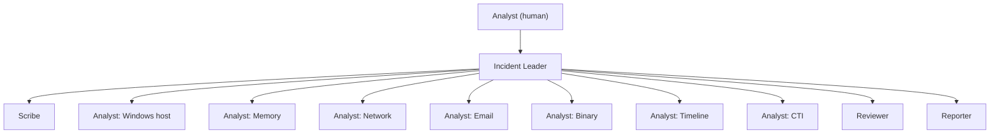
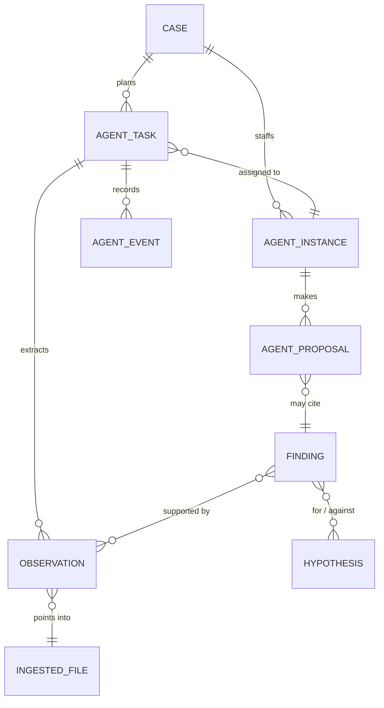

# Charybdis — Agent team module

A proposal under construction on `feat/s30-charybdis-foundations`. Nothing here
is built yet. Feature catalogue and arrival plan: [CHARYBDIS_FEATURES.md](CHARYBDIS_FEATURES.md).

Charybdis is a team of AI agents that works a Remora case alongside the
analyst: an **Incident Leader** that asks the structuring questions and
dispatches work, **analysts** that run Remora's parsers and queries against the
case's artifacts, a **reviewer** that challenges conclusions, a **scribe** that
drafts the incident log, and a **reporter** that turns validated findings into
report sections. Local models (Ollama) by default, third-party providers by
explicit opt-in, gated by the case TLP.

---

## 1. Why inside Remora rather than beside it

Charybdis started as a separate repository. It moved here before any code was
written, because most of what an agent team needs already exists in Remora and
already obeys rules that took sprints to establish:

| Charybdis needs | Remora already has |
|---|---|
| Evidence intake, hashing, deduplication | `services/ingest/` state machine, `ingested_files` |
| Chain of custody | `services/custody.py`, `routers/custody.py` |
| Parsers run safely on hostile input | EZ tools, Chainsaw, Volatility, PCAP behind `services/sandbox.py` |
| Querying millions of rows | `ArtifactStore` (`search`, `aggregate`, `find`, `schema`) and RQL |
| Incident log, timeline, IOCs, assets, TTPs, attack graph | One model and router each |
| Client, TLP, severity, case type | `Case`, `Client` |
| Who did what | `audit_log`, enforced on every mutating route |
| Who may do what | Default-deny permission sets, client scoping |
| Live updates | Per-case WebSocket (`core/collab_manager.py`) |
| Report generation | `report_service.py`, `report_sections_data`, DOCX/Markdown templates |
| CTI enrichment | `ConnectorConfig` (VirusTotal, AbuseIPDB, MISP) |

Building beside Remora would have meant re-implementing each of these, then a
merge that rewrites half of it to fit Remora's conventions. Building inside it
means agents are a new kind of **actor** on objects Remora already owns.

The cost is Remora's discipline (English gate, migration gate, audit gate,
page contract, one PR per sprint). That is accepted: those gates are exactly
what keeps an autonomous system honest.

Containment, so the module can ship dark and be removed cleanly:
- Feature flag `CHARYBDIS_ENABLED` (default `false`). Off means no router
  registered, no worker started, no tab rendered.
- Engine code lives in one package, `services/charybdis/`. The rest of Remora
  never imports from it; it calls into Remora services, never the reverse.
- Its tables are prefixed `agent_` and dropped by a single downgrade.

---

## 2. Principles

| # | Principle | Consequence |
|---|---|---|
| P1 | **Agents propose, analysts dispose.** | An agent never writes an IOC, timeline pin, TTP, log entry or report section directly. It creates an `agent_proposal`; accepting it calls the same service the UI calls, so the resulting object is indistinguishable from a hand-made one and audited as such. |
| P2 | **No finding without evidence.** | A finding cites at least one observation, and an observation points at a concrete record: `ingested_file` + `ArtifactStore.find()` id, or a parser output row. A claim without one is a hypothesis. |
| P3 | **Hypothesis is not fact.** | Separate states and an explicit confidence with its justification. |
| P4 | **Everything is visible.** | Every model turn, tool call, tool result and inter-agent message is an `agent_event`, streamed live and kept. |
| P5 | **Data stays where the TLP says.** | TLP:RED and TLP:AMBER+STRICT cases can only reach local providers. Enforced in the LLM gateway, not in the agent. |
| P6 | **Agents are bounded.** | Step, token and wall-clock budgets per task. Inter-agent requests go through the Incident Leader, so two agents cannot loop on each other. |
| P7 | **Artifact content is untrusted input.** | An email body or a script can contain instructions aimed at the model. Data is fenced in prompts, tools are typed (no free shell), anything with side effects needs approval. |

---

## 3. Agents as actors

An agent instance acts **on behalf of the analyst who started it**, with a
permission set that is a strict subset of that analyst's:

- A built-in permission bundle `agent` in `core/permissions.py`: read case
  data, run read-only queries and parsers, create proposals and agent events.
  No delete, no user or client administration, no export.
- Effective permissions are the intersection of `agent` and the launching
  user's own set. Client scoping applies unchanged, so an agent cannot see a
  case its analyst cannot.
- Audit entries carry the human as `actor` and the agent instance in
  `detail` (`agent:analyst-windows-1`). Filtering the Audit page for `agent.`
  finds everything agents did.

---

## 4. Team and roles



| Role | Works on (Remora) | Produces |
|---|---|---|
| Incident Leader | Case metadata, coverage, task board, findings | Scoping questions, hypotheses, tasks, syntheses |
| Windows host | Explorer (EZ outputs), EVTX, Chainsaw, registry, process tree | Observations, findings, IOC/timeline proposals |
| Memory | Memory analysis (Volatility) | idem |
| Network | PCAP hosts, flows | idem |
| Email | Email analysis, case emails | idem |
| Binary | Binary analysis | idem |
| Timeline | Timeline, all observations | Consolidated chains of events, attack-graph proposals |
| CTI | IOCs, connectors, MITRE | Enrichment, TTP proposals |
| Reviewer | Proposed findings and their evidence | Verdict per finding, alternative explanations |
| Scribe | Agent and analyst events | Incident-log entry proposals |
| Reporter | Validated findings, timeline, TTPs | Report-section proposals |

Several instances of one role may work a case (`analyst-windows-1` on the DC,
`analyst-windows-2` on the first workstation).

Roles and their processes are **YAML under `templates/agents/`**, like case
templates: analyst-authored content, versioned, editable, exempt from the
English gate for their prompt text.

---

## 5. Architecture

```mermaid
graph LR
    subgraph FE["frontend"]
        TEAM["Case tab: Team"] --- CHAT[Chat] --- TASKS[Tasks] --- INBOX[Proposals inbox]
    end
    subgraph BE["backend"]
        R["routers/agents.py, agent_tasks.py, agent_proposals.py"] --> S["services/charybdis/"]
        WS["/ws/cases/{id}/agents"] <-- BUS[event bus]
        subgraph S["services/charybdis/"]
            SCHED[scheduler] --> RUN[runner]
            RUN --> PROC[process engine]
            RUN --> GW[LLM gateway]
            RUN --> TOOLS[tool registry]
            RUN --> POL[policies]
        end
        TOOLS --> SVC["existing services: store, ingest, evtx, chainsaw, memory, pcap, process_tree, cti, mitre, report"]
        S --> BUS
    end
    GW --> OLL[("Ollama on the host")]
    GW -.-> CLOUD[("Anthropic / OpenAI / compatible")]
    SVC --> DB[(SQLite)]
    SVC --> PQ[(Parquet / DuckDB)]
```

### 5.1 Layout

Models, schemas and routers follow Remora's flat checklist; the engine is one package.

```
backend/app/
├── models/agent.py              # AgentInstance, AgentTask, AgentEvent, AgentProposal, Finding, Observation, Hypothesis
├── schemas/agent.py
├── routers/agents.py            # instances, chat, tasks, proposals, findings
└── services/charybdis/
    ├── runtime/                 # scheduler, runner, process engine, messaging, budgets
    ├── llm/                     # LLMProvider protocol + ollama, openai_compat, anthropic, openai
    ├── tools/                   # one adapter per Remora capability
    ├── policies/                # TLP routing, approvals, permission intersection
    ├── definitions.py           # loads templates/agents/*.yaml
    └── events.py                # typed event bus → WebSocket
templates/agents/
├── roles/*.yaml
├── processes/*.yaml
└── prompts/*.md
frontend/src/
├── api/agents.ts
├── components/case/tabs/TeamTab.tsx   # org chart + chat + task board
└── components/agents/                  # AgentCard, AgentTrace, ProposalCard, FindingCard
```

### 5.2 Data model



| Table | Notes |
|---|---|
| `agent_instances` | case, role id, display name, provider + model, budget, status, launched_by |
| `agent_tasks` | objective, targets (ingested file ids, hosts), process id, current step, parent and dependencies, status, budget used |
| `agent_events` | append-only; kind (`thought`, `tool_call`, `tool_result`, `message`, `status`), payload JSON, token counts, `prev_hash` chaining for tamper evidence |
| `agent_observations` | raw fact with a precise pointer: `ingested_file_id`, store record id or row key, tool and version |
| `agent_findings` | title, description, severity, confidence + justification, ATT&CK ids, state `proposed → reviewed → validated / rejected` |
| `agent_hypotheses` | statement, state, confidence |
| `agent_proposals` | target kind (`ioc`, `timeline_pin`, `ttp`, `incident_log`, `asset`, `attack_graph_edge`, `report_section`, `task`), payload, state, decided_by, decided_at |
| `llm_providers` | kind, base URL, encrypted key (same at-rest encryption as the MFA secret), locality `local` / `cloud` |

All timestamps UTC; every FK `ondelete="CASCADE"`; migration in the same commit.

### 5.3 Runtime

A small, owned loop rather than LangGraph, CrewAI or AutoGen: every step must
be journaled, bounded and replayable, and small local models need short
prompts and validated structured output, which is easier to guarantee when the
loop is ours. MCP and external agents plug in at the edges (section 7), not in
the core.

Per step of the agent's process: build context (role prompt, step
instructions, task memory, a filtered view of the case) → call the model with
the tools allowed at that step → validate any tool call against its schema →
apply policy (allowed? side effect? → approval) → run the tool → record →
repeat until the step's exit schema validates or the budget runs out →
transition. Invalid output is retried with the validation error, then escalated.

Tool results never flood the context: a parser writes Parquet as it already
does, the agent receives a summary and pages through it with `search` / `aggregate`.

**Where it runs.** S30 starts in-process: an asyncio supervisor started on
application startup when the flag is on. Agent loops are long and outlive
requests, which `BackgroundTasks` was not designed for. If SQLite write
contention or restarts become a problem, the same entry point moves to a
`remora-agents` container sharing the database and data volume.

### 5.4 Processes

A process is a state machine in YAML: steps, instructions, allowed tools,
output schema, transitions, escalation conditions.

```yaml
# templates/agents/processes/analyst-generic.yaml
id: analyst-generic
initial: understand
steps:
  understand: { output: TaskUnderstanding, next: plan }
  plan:       { output: AnalysisPlan, next: execute }
  execute:    { tools: "@role", output: ObservationBatch, loop_until: plan_completed, next: findings }
  findings:   { output: FindingDrafts, next: self_check }      # each draft cites >= 1 observation
  self_check: { output: SelfCheck, next: report,
                escalate_if: "high_severity_with_low_confidence" }
  report:     { output: TaskReport, terminal: true }
```

```yaml
# templates/agents/roles/analyst-windows.yaml
id: analyst-windows
name: Windows host analyst
reports_to: incident-leader
process: analyst-generic
model: { provider: ollama, name: qwen3:8b, num_ctx: 32768, temperature: 0.2 }
tools: [case_overview, store_search, store_aggregate, evtx_events, chainsaw_hunt,
        process_tree, registry_query, ingest_status, propose]
budget: { max_steps: 40, max_tokens: 200000, max_minutes: 30 }
autonomy: propose
prompt: prompts/analyst-windows.md
```

The vocabulary of tools, proposal kinds and event kinds is a registry in code
(`services/charybdis/tools/registry.py`, …); the documentation tables are
generated from it, per the "a list that exists twice will drift" rule.

### 5.5 Messaging

Typed messages, each an `agent_event`: `task.assign`, `task.report`,
`help.request`, `question.human`, `review.request`, `review.verdict`, `info`.
Hub-and-spoke through the Incident Leader by default: an analyst asks for help,
the leader decides whether and to whom a task goes.

### 5.6 LLM gateway

```python
class LLMProvider(Protocol):
    kind: str                # "ollama" | "openai_compat" | "anthropic" | "openai"
    locality: Locality       # LOCAL | CLOUD
    async def chat(self, req: ChatRequest) -> AsyncIterator[ChatChunk]: ...
    async def list_models(self) -> list[ModelInfo]: ...
```

- Ollama first (native `/api/chat`, tool calls, JSON format). The backend runs
  in Docker and Ollama on the Windows host with the GPU: compose gains
  `extra_hosts: ["host.docker.internal:host-gateway"]`, default base URL
  `http://host.docker.internal:11434`.
- TLP policy, token accounting and cost per agent, task and case live here.
- One request queue per provider with configurable concurrency. On the
  reference workstation (RTX 3060 Ti 8 GB, 32 GB RAM) one ~8B model fits in
  VRAM, so agents share it and the scheduler avoids model swaps; real
  parallelism comes from parsers running on the CPU meanwhile.
- The currently installed `llama3` has no native tool calling. Candidates to
  benchmark: Qwen3 8B/14B, Llama 3.1 8B, Mistral Nemo 12B.

### 5.7 Tools

Agents never get a shell. Each tool is a typed adapter over a Remora service
that already exists and is already sandboxed:

| Tool | Backed by |
|---|---|
| `case_overview` | `Case`, `Client`, coverage |
| `ingest_status` | `ingested_files` |
| `store_search`, `store_aggregate`, `store_find`, `store_schema` | `ArtifactStore` + RQL parser |
| `evtx_events`, `chainsaw_hunt` | EVTX and Chainsaw services |
| `process_tree` | `services/process_tree.py` |
| `registry_query` | `services/registry.py` |
| `memory_plugin` | memory router services |
| `pcap_hosts`, `pcap_flows` | `services/pcap.py` |
| `email_inspect`, `binary_inspect` | email and binary analysis |
| `cti_lookup` (approval required: data leaves the host) | `ConnectorConfig` connectors |
| `mitre_lookup` | cached ATT&CK tree |
| `propose` | `agent_proposals` |
| `record_observation`, `propose_finding`, `review_finding` | `agent_observations`, `agent_findings` |
| `report_outline`, `propose_report_section`, `propose_executive_summary` | case template sections, `agent_proposals` |
| `list_memory_dumps`, `memory_output` | Volatility plugin results already run (read only) |
| `list_emails`, `read_email`, `list_binaries`, `read_binary` | email and binary analysis results |
| `store_aggregate` | `ArtifactStore.aggregate` |
| `record_source_observation` | quotes a memory line, an email part or a binary entry into `agent_observations` |
| `propose_log_entry` | `agent_proposals`, accepted through the incident log handler |
| `ask_human`, `request_help`, `report` | messaging |

---

## 6. Interface

- A **Team** case tab (full height): live org chart on the left, chat in the
  centre (thread with the Incident Leader, a thread per task, direct threads
  with any agent), selection `SidePanel` on the right (agent card or task
  detail with its trace).
- A **Proposals** inbox per case: accept, edit-then-accept, reject with a
  comment that goes back to the author agent.
- Findings and hypotheses board; citations open the cited row in the Explorer
  `SidePanel`.
- Settings page for providers, models per role, TLP policy.
- Built from the primitives (`PageShell`, `Panel`, `DataTable`, `SidePanel`,
  `Toolbar`, `FilterChips`, `StatTile`, `EmptyState`), graph on the shared
  ReactFlow components, icons via `ui/icons.ts`.
- New semantic tokens in `styles/tokens.css` for agent state, in every theme:
  `--agent-idle`, `--agent-thinking`, `--agent-tool`, `--agent-waiting`,
  `--agent-blocked`, `--agent-done`.

---

## 7. Openness

- **MCP server**: Remora's agent tools exposed over MCP, so Claude Code or any
  MCP client can work a case with the same permissions and audit as a built-in agent.
- **MCP client**: third-party MCP servers (Velociraptor, MISP, internal tools)
  registered as tools, each with a locality and an approval flag.
- **External agents** later (A2A or similar), as agent instances whose loop
  runs elsewhere but whose events and proposals land here.

---

## 8. Open questions

1. In-process supervisor or `remora-agents` container from day one? (S30 ADR)
2. Does `agent_findings` stay agent-only, or become Remora's first-class
   finding model for human analysts too? Remora has none today.
3. Default autonomy: `propose` everywhere, or let read-only tools run without
   per-call approval? (Proposed: read-only runs freely, side effects ask.)
4. Which public datasets make up the evaluation bench (`samples/` already holds some)?
